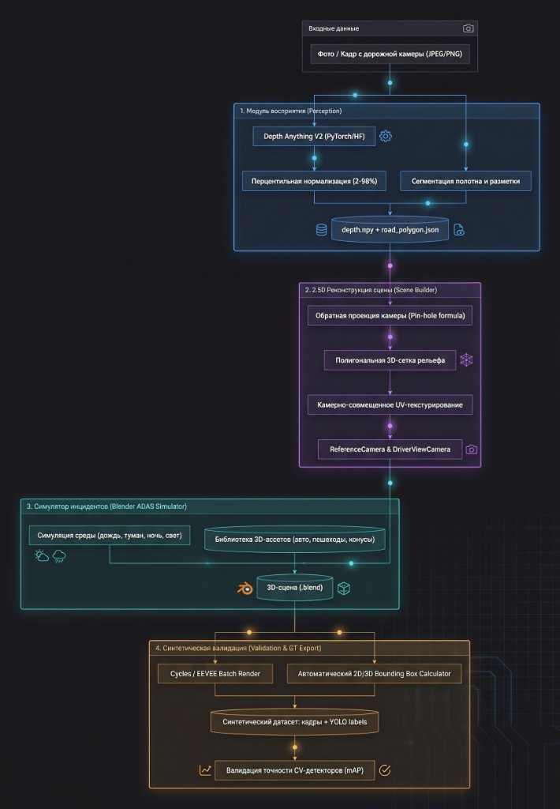

# RoadCam → Blender (2.5D Camera-Matched Digital Twin)

Автоматическая система реконструкции дорожных сцен из одиночных фотографий в редактируемые 3D-сцены Blender (`.blend`) на базе легковесной нейросети **Depth Anything V2 Small** (Apache-2.0) и математически точной обратной перспективы камеры.



---

## Что делает новый метод (RoadCam 2.5D)

1. **Оценка монокулярной относительной глубины на CPU / GPU (`depth_estimator.py`)**:
   - Использует официальную модель `Depth Anything V2 Small` через Hugging Face Transformers.
   - Выполняет бикубическую интерполяцию и перцентильную нормализацию `[2%, 98%]` для устранения выбросов и шумов.
   - Сохраняет карту глубины `depth.npy` и визуализацию `depth_preview.png`.

2. **2.5D Camera-Matched Реконструкция в Blender (`build_scene.py`)**:
   - Создаёт сглаженную триангулированную сетку сцены (`RoadScene_2.5D_Reconstruction`) заданной плотности (`grid`, по умолчанию 240).
   - Применяет точную формулу обратной перспективы камеры:
     $$\begin{aligned}
     X &= (u - 0.5) \cdot 2.0 \cdot d \cdot \tan(\text{HFOV}/2) \\
     Y &= (0.5 - v) \cdot 2.0 \cdot d \cdot \tan(\text{HFOV}/2) \cdot (H / W) \\
     Z &= -d
     \end{aligned}$$
   - **Результат:** из камеры наблюдения (`ReferenceCamera`, 50mm) сцена **на 100% совпадает с исходной фотографией**, а при свободном вращении в Blender полотно дороги, деревья, автомобили, отбойники и мосты обладают честной 3D-глубиной и рельефом.
   - Дополнительно добавляется `DriverViewCamera` для быстрого осмотра сцены с уровня дороги.

3. **Интеграция в Blender Add-on (`cv_builder`)**:
   - Плагин обновлён и синхронизирован с установленной версией в Blender 4.1 (`View3D > Боковая панель (N) > ADAS Simulator`).
   - Переключатель режимов:
     - **RoadCam 2.5D (Новый метод)** — непрерывный 3D-рельеф всей сцены с оптическим сопоставлением.
     - **Сегментированный Twin** — раздельные слои полотна дороги, разметки полос и отбойников.
   - Возможность спавнить объекты (авто, пешеходы, конусы) и экспортировать Ground Truth датасет для YOLO.

---

## Быстрый запуск из консоли (CLI)

### На тестовых изображениях из новой папки:
```bash
# Шоссе
python run_pipeline.py --image "samples/roadcam_highway.jpg" --output "output_highway"

# Камера наблюдения
python run_pipeline.py --image "samples/roadcam_camera.jpg" --output "output_camera"
```

### Настройки параметров:
- `--grid 240` — плотность сетки (больше деталей рельефа, по умолчанию 240).
- `--depth-strength 1.0` — выраженность 3D-рельефа (по умолчанию 1.0).
- `--render-samples 64` — число сэмплов рендера Cycles.
- `--no_render` — создать только `.blend` файл без выполнения контрольного рендера.

---

## Использование через плагин в Blender (GUI)

1. Откройте **Blender 4.1**.
2. В 3D Viewport нажмите клавишу **`N`** и перейдите во вкладку **`ADAS Simulator`**.
3. В блоке **① 3D-Окружение — Цифровой двойник дороги**:
   - В поле **«Референсный кадр»** выберите фото (например, `samples/roadcam_highway.jpg`).
   - Убедитесь, что выбран режим **«RoadCam 2.5D (Новый метод)»**.
   - Нажмите **«Построить 3D-сцену (RoadCam 2.5D)»**.
   - Сцена мгновенно построится прямо в текущем окне Blender и вьюпорт переключится в ракурс камеры.
4. В блоке **② Настройка сценария** добавляйте препятствия на дорогу и проверяйте детекцию для YOLO в блоке **③**.
